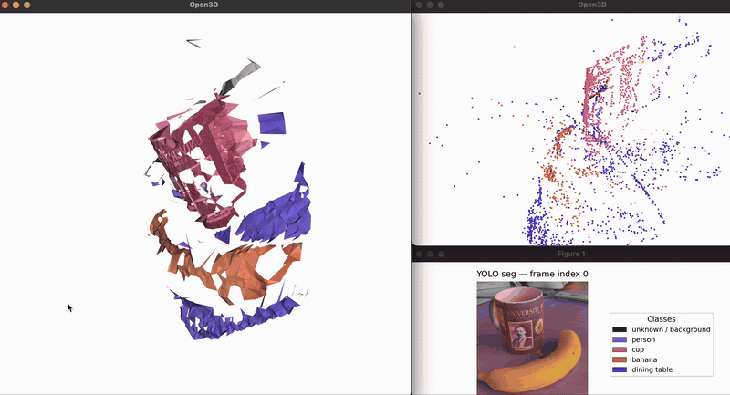
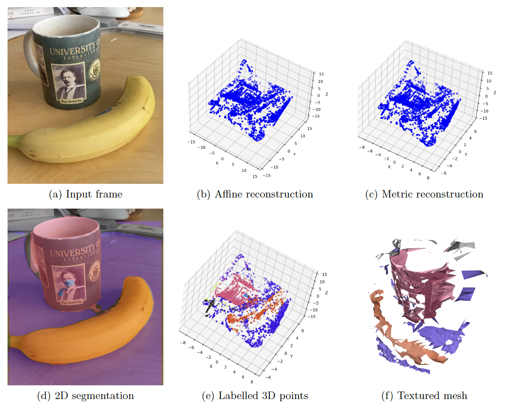
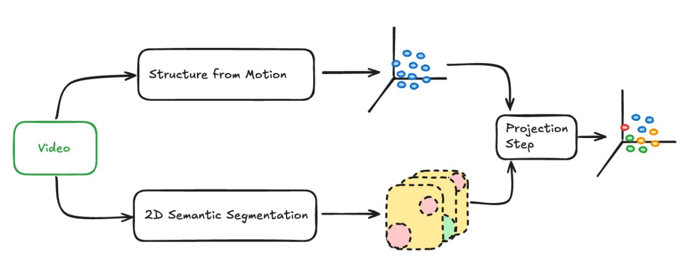

# Semantic Segmentation on SfM Reconstructed 3D Point Clouds

Take a few seconds of phone video, get back a 3D point cloud and mesh where every point knows what object it belongs to. Structure-from-motion for the geometry, a pretrained YOLO11 for the labels.

Write-up: [docs/report.pdf](docs/report.pdf)



Mesh on the left, labeled points and the YOLO mask of frame 0 on the right. Full recordings: [demo 1](docs/demo1.mp4), [demo 2](docs/demo2.mp4) (different scene).



## why care

Labeled 3D data is expensive. You either pay for LiDAR or you pay someone to annotate point clouds by hand, and both scale badly. Meanwhile 2D segmentation is basically solved and free. I think geometry gets you a lot further than people assume: a handheld video, classic factorization SfM, and the per-pixel labels projected into 3D. No generative model, no depth sensor, runs on a laptop.

I did this as a computer vision research project at the University of Alberta. Theory, metrics and experiments are in [the report](docs/report.pdf).

## run it

Python 3.12+. Weights (`code/yolo11n-seg.pt`) and two test clips are in the repo. On Apple Silicon the Open3D wheel wants `brew install libusb`, which took me a while to figure out.

```bash
uv venv --python 3.12 && source .venv/bin/activate
uv pip install -r requirements.txt
cd code
python video_to_3d.py ../test_media/multiple.mov -o ../out/multiple \
  --yolo yolo11n-seg.pt --feature-max-corners 3000 --max-frames 90
```

An Open3D window pops up with the mesh at the end (`--no-mesh` to skip). Everything lands in `out/multiple/`: the tracks, the point cloud (`q2_S_scaled.npy`), the mesh (`.obj` / `.ply`), the per-frame class maps, and `metrics.txt`. `out_test/` is a run I committed so you can see what the output looks like without running anything.

`python view_pipeline_3d.py --out-dir ../out/multiple` reopens a finished run.

## how it works



Two independent passes over the same video, joined at the end.

SfM side: Shi-Tomasi corners, pyramidal Lucas-Kanade tracking, stack the tracks into a 2F x P matrix, rank-3 SVD gives affine structure, then the metric upgrade from the usual orthogonality constraints (|r1|=|r2|=1, r1·r2=0, solve for the 3x3 correction, Cholesky). Segmentation side: YOLO11-seg on every frame. Each track gets the class it was inside most often across frames. Then Delaunay on frame 0 to mesh it.

Where to look:
- `code/feature_tracker.py` - detection, tracking, re-detection, writes `tracks.txt`
- `code/q1_affine_factorization_method.py`, `code/q2_metric_upgrade.py` - the factorization math
- `code/yolo_segmentation.py`, `code/q3_texturing.py` - labels and meshing
- `code/reconstruction_pipeline.py` - glues it together

## why the mesh looks like that

Meshing. There's no real surface reconstruction here. I triangulate the tracked points in 2D on the first frame, which is cheap and hands you UV coordinates for free (frame 0 is the texture). But 2D Delaunay has no idea about depth, so it cheerfully connects a point on the mug to a point on the wall behind it and you get long spikes through space.

Three filters in `q3_texturing.py` deal with that. Drop a triangle if its longest 2D edge is over some fraction of the image diagonal, or its longest 3D edge is over some fraction of the cloud's bounding box, or two of its vertices carry different YOLO classes (a triangle spanning two objects is almost always a depth jump). Tight thresholds kill spikes and leave holes, loose ones keep the surface and let spikes back in. 0.058 and 0.10 were tuned by looking at meshes until they stopped being awful. If the 3D filter wipes out everything it relaxes 1.5x, then gives up and uses 2D only.

I like that the labels end up doing two jobs: they're the output, and they also fix the geometry.

Also, longer clips kept getting OOM-killed. Fix was to track on downscaled grayscale frames, free them, and let YOLO stream the file in a second pass instead of holding every frame in RAM.

## stack

Python, NumPy, SciPy, OpenCV, Ultralytics YOLO11, Open3D, Matplotlib.

## status

Works end to end on short clips. Rough edges:
- Affine camera assumption, so reprojection error on handheld video is high. Bundle adjustment would be the next thing.
- Scale is arbitrary (unit RMS radius by default). `--scale-ref I J DIST` pins it if you know a real distance between two tracked points.
- No tests. Deps aren't pinned.

## license

MIT.
